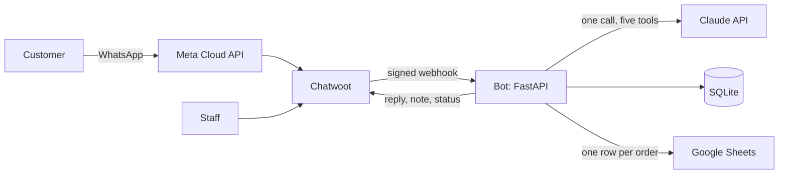

# whatsapp-order-agent

Takes orders over WhatsApp for a small business and hands off to a person in Chatwoot. FastAPI and Claude tool use.

[](https://github.com/nachixxs/whatsapp-order-agent/actions/workflows/ci.yml) [](LICENSE) [](.python-version)

**Status:** checkpoints 1 to 5 of the roadmap are merged to `main`. Open: three manual checks with a real phone, and the production deploy, which lives in a separate private repo.

<!-- capture: Chatwoot (local), conversation of the fictional "Imprenta Ejemplo": customer asks for 500 tarjetas, bot summary, internal note after a price question; 1200 px wide, under 1 MB -->

## The problem

A print shop takes orders over WhatsApp as free-form messages spread over a day, often missing the size, the quantity, whether the design exists or the date. Each order has to end up as one row in a Google Sheet, and anything about price, deadline or stock needs a person.

## What it does

- Collects the seven fields of an order (`producto`, `material`, `medidas`, `cantidad`, `tiene_diseno`, `fecha_necesita`, `nombre_cliente`) across several messages and asks only for what is missing.
- Shows a summary and writes the row to the sheet once, after the customer confirms.
- Answers eight FAQ topics (address, hours, shipping, parking, quotes, payment, how to send files, catalogue) from the business config.
- Hands the conversation to a person, with an internal note that summarises the order, when the customer asks for one, asks a price or a deadline, or asks about stock. It never quotes a price, a deadline or a deposit.

The customer writes in Spanish and the bot answers in Spanish. With the sample business ("Imprenta Ejemplo"), on a Sunday afternoon:

| Customer | Bot |
|---|---|
| "necesito 500 tarjetas" | Asks for the next missing field |
| (all seven fields given) | "Te leo el pedido, Marta: - Trabajo: Impresión digital - Material: cartulina 300g - Medidas: 9x5 cm - Cantidad: 500 - Diseño: ya lo tenés - Lo necesitás para el martes 20 de octubre ¿Está todo bien? ..." |
| "dale" | Writes one row, answers "¡Listo! Ya guardamos tus datos. ..." |
| "¿cuánto sale?" | "El precio y el plazo te los confirma un asesor, no te los puedo dar yo. Ya le dejo tu consulta, y te va a contestar cuando volvamos a abrir: el martes 13 de octubre desde las 09:00." The conversation moves to `open` with a note. |

The sample config lists 2026-10-12 as a holiday, which is why Monday is skipped. These texts come from `app/respuestas.py`.

## How it works



1. Chatwoot posts each incoming message to `/webhook/chatwoot`. The bot checks the HMAC signature, the account and the inbox, answers `200` and works in the background.
2. It drops message ids it has already seen, loads the stored conversation from SQLite and calls the model once.
3. The model returns one tool call. Code validates it, updates the order and picks a reply from `app/respuestas.py`.
4. On a confirmation, code appends the row. On a handoff, code posts an internal note and sets the conversation to `open`, where the bot stops answering.

More detail, module sizes and the confirmation state machine: [docs/ARCHITECTURE.md](docs/ARCHITECTURE.md).

## Engineering decisions

- **One tool call per turn, and Python writes every reply.** The model chooses; it never writes what the customer reads. Discarded: forcing a tool with `tool_choice: any` (the model answers `400` to it, per the spec) and filtering model text for prices. Cost: stiff replies, and a wording change is a code change. [ADR 0001](docs/adr/0001-one-tool-per-turn-python-writes-the-reply.md).
- **Own history with markers (`[dato_faltante: material]`) instead of the bot's prose.** Measured on the previous bot: with prose the model called a tool 0 of 3 times, with markers 3 of 3. Discarded: reading the history from Chatwoot. Cost: a second store of state, so one worker only. [ADR 0002](docs/adr/0002-own-history-with-markers.md).
- **Atomic confirmation.** "sí" and "dale" a second apart write one row: the pending order is taken in one SQLite transaction. Discarded: retrying the sheet write, because a retry after a timeout leaves a second row. Cost: a failed write needs one more "sí", and an order held by a crashed process is released without being written. [ADR 0003](docs/adr/0003-atomic-confirmation-and-one-row-per-order.md).
- **Chatwoot as inbox and handoff instead of a custom WhatsApp layer.** Discarded: handling Meta's webhooks directly, as the previous bot did. Cost: seven open questions about Chatwoot `v4.18.0` had to be answered against a running instance (it sends events in any conversation status; it moves the conversation to `open` itself if the bot takes over 5 s), and a local instance used about 950 MB of RAM at rest in the CP1 measurement.
- **One clock.** Every business decision uses `config.ahora()` in the business time zone. Discarded: `datetime.now()`, which returns UTC in a container and would make the bot say "closed" at 10 am. Cost: each time-dependent function takes `ahora` as a required argument, and a test fails if `datetime.now(` or `date.today(` appears outside `app/config.py`.

## LLM

- **Model:** `claude-sonnet-5-5`, set in `app/agente.py` (`MODELO`). Adaptive thinking, effort `low`, `tool_choice: auto` with parallel calls disabled, `strict` tools, timeout 25 s (5 s to connect), SDK retries off, one retry only on a connection error.
- **Model decides:** which of the five tools fits the message and its arguments. **Code decides:** whether the arguments are valid (field by field), what the order looks like, every sentence the customer reads, and every write. The tool set is fixed in `app/tools.py`.

| Tool | What the model chooses | Effect, done by code afterwards |
|---|---|---|
| `registrar_pedido` | Order fields the customer just gave | Writes the order in progress to SQLite; no sheet access |
| `pedir_dato_faltante` | Which missing field to ask for | Sends a fixed question; writes a history marker |
| `consulta_general` | One of 8 FAQ topics | Reads the config and sends a fixed answer |
| `derivar_a_asesor` | One of 4 reasons | Posts an internal note and sets the conversation to `open` in Chatwoot |
| `confirmar_pedido` | `acepta` true or false | On true, appends the sheet row |

- **Prompt and tool descriptions:** `app/prompt.py` (static block, cached; dynamic block with date and order) and `app/tools.py`. Both are measured artifacts: reordering one clause of the previous bot's prompt dropped a routing case from 6/6 to 3/6, so any edit is followed by the routing battery.
- **Evals** (separate from the 798 unit tests):
  - Set: `tests/ruteo/casos.json`, 60 synthetic cases, 17 marked critical. Command: `uv run --locked python scripts/medir_ruteo.py` estimates the cost without network; adding `--correr` sends the Batch API run and spends money.
  - Public set, 2026-10-12, `claude-sonnet-5-5`, effort low, 3 runs with the current prompt: 100 % in every run (60/60, critical cases 17/17), US$ 0.35 measured against US$ 0.52 estimated. The first run, 2026-09-29 with an earlier prompt: 98.3 %, 100 %, 100 %, US$ 1.17.
  - First real configuration (private case set and config), 2026-10-10, 102 cases x 3 runs: 97.1 % in every run, critical cases 22/22, US$ 0.63 measured. Three cases fail in every run and are accepted until the next prompt change. The pass bar is 95 % per run plus every critical case right in every run.
  - Estimate for the public set: US$ 0.52 with Batch and cache, US$ 1.46 without cache. The script's price constants are marked `VERIFICAR` for this model.
  - Not covered: multi-turn flows, the final text, latency, adversarial input. One author wrote the cases.
- **Cost and latency per operation:** one manual session in the local Chatwoot (CP4, 7 scenarios) made 8 API calls: 7,016 input, 949 output, 10,024 cache-write and 30,090 cache-read tokens, about US$ 0.06 in total (project notes). Latency per call: not measured yet. Next step: add elapsed time to the `agente:` log line and read the median and p95 over a week of traffic.
- **If the API fails or is slow:** `decidir` returns a typed error and never raises. The customer gets "Uf, se me complicó procesar tu mensaje. ¿Me lo escribís de nuevo en un rato?", with no handoff. The webhook already got its `200`, so Chatwoot does not resend: the customer has to write again. The order in progress stays in SQLite. A response with no tool, or a refusal, gets a fixed re-ask and no retry.
- **Personal data:** the model receives the business config, the WhatsApp profile name (or the literal "cliente"), the order fields, and up to 20 stored messages (customer text, each cut at 4,096 characters, plus the bot's markers). It never receives the phone number: no tool takes it (tested) and the prompt has none. SQLite holds messages and the order, including the phone, for up to 6 hours; the sheet row has the phone; Chatwoot keeps the conversation. Logs carry a per-process salted alias, the tool name, argument keys (never values) and token counts. Whatever the customer types goes to the Claude API.
- **Prompt injection**, with the defenses that exist in the code:
  - LLM06 Excessive Agency: five tools with enum arguments and `extra="forbid"`; none takes `telefono`; no tool call touches the sheet or Chatwoot by itself. The only `append_row` is in `confirmacion.confirmar`, after validation.
  - LLM05 Improper Output Handling and LLM07 System Prompt Leakage: model text is never sent, so injected text can change which tool is picked, not what the bot says. Fields echoed in the summary and notes are cut to one line (60 characters for the name, 200 for the rest), notes strip links and `mention://`, and the sheet is written as `RAW`, so `=IMPORTXML(...)` stays text.
  - LLM10 Unbounded Consumption: 30 customer messages per conversation, then a handoff without an API call.
  - Content in `tool_result`: not applicable. The app sends no `tool_result` blocks and never downloads attachments.
  - Gap: no injection case in the battery yet.

## Getting started

Needs [uv](https://docs.astral.sh/uv/) (CI pins 0.12.17); `.python-version` selects Python 3.14. The tests run without credentials or network:

```bash
git clone https://github.com/nachixxs/whatsapp-order-agent.git
cd whatsapp-order-agent
uv run --locked pytest
```

```text
798 passed in 40.48s
```

To run the bot, the business config is `config/negocio.json` (git-ignored); the sample is `config/negocio.ejemplo.json`:

```bash
cp config/negocio.ejemplo.json config/negocio.json
cp .env.example .env
uv run --locked uvicorn app.main:app --reload --port 8020
```

> [!NOTE]
> A full conversation needs a Chatwoot instance, an Anthropic API key and a Google service account. Without the Chatwoot variables the server starts and `/salud` answers `503`.

For a local Chatwoot, copy `chatwoot.env.example` to `.env.chatwoot`, replace the placeholder secrets and run `docker compose -f compose.chatwoot.yml up -d`. Open http://localhost:3030, create an account and an inbox, create an Agent Bot whose outgoing URL is `http://host.docker.internal:8020/webhook/chatwoot` (no `?token=`), and put the ids, tokens and secret in `.env`. With all six `CHATWOOT_*` variables set, `http://localhost:8020/salud` shows `{"estado":"ok"}`. Stop Chatwoot with `docker compose -f compose.chatwoot.yml down`.

The sheet needs a tab named `Pedidos` with these headers in this order, shared with the service account: `fecha_ingreso, nombre_cliente, telefono, producto, material, medidas, cantidad, tiene_diseno, archivos, fecha_necesita, anticipo` (`anticipo` stays empty by design).

| Variable | Group | Purpose | Required | Comes from |
|---|---|---|---|---|
| `CHATWOOT_URL` | local | Chatwoot base URL | yes | `http://localhost:3030` |
| `CHATWOOT_ACCOUNT_ID`, `CHATWOOT_INBOX_ID` | local | Events from any other account or inbox are dropped | yes | your Chatwoot |
| `CHATWOOT_BOT_TOKEN` | local | Agent Bot token: replies, notes, status | yes | your Chatwoot |
| `CHATWOOT_AGENTE_TOKEN` | local | Agent without inboxes, only to write contact attributes | yes (`/salud` is 503 without it) | your Chatwoot |
| `CHATWOOT_WEBHOOK_SECRET` | local | Agent Bot secret that signs events; empty never matches | yes | your Chatwoot |
| `MEMORIA_RUTA` | local | SQLite file | no, default `memoria.db` | you choose |
| `CHATWOOT_CAPTURAR_PAYLOADS` | local | Saves raw webhook bodies to `capturas/` (real customer data, git-ignored) | no | any value |
| `ANTHROPIC_API_KEY` | third-party test | Claude API, read on the first call | for real turns and `--correr` | Anthropic |
| `GOOGLE_CREDENCIALES` | third-party test | Path to the service-account JSON, outside the repo | to confirm an order | Google Cloud |
| `SHEET_ID` | third-party test | Text between `/d/` and `/edit` in the sheet URL | to confirm an order | the sheet |

No variable in `.env.example` is production-only. The WhatsApp channel is configured inside Chatwoot, and with it connected `FRONTEND_URL` in `.env.chatwoot` must be the public tunnel URL. No test needs any of these variables: `tests/conftest.py` removes them.

If something fails: `FileNotFoundError: Falta la config del negocio` means the `cp` of `negocio.ejemplo.json` is missing. Chatwoot rejects a private-network webhook URL unless `SAFE_FETCH_ALLOW_PRIVATE_NETWORK=true`, which `compose.chatwoot.yml` sets for local use only. The server refuses to start with more than one worker. A log line "autenticacion fallida" means the webhook secret differs from the Agent Bot's.

## Tests

| Suite | Command | Needs |
|---|---|---|
| Unit and integration | `uv run --locked pytest` | Nothing: no network, no credentials |
| Routing cost estimate | `uv run --locked python scripts/medir_ruteo.py` | Nothing |
| Routing battery | `uv run --locked python scripts/medir_ruteo.py --correr` | `ANTHROPIC_API_KEY`; spends money |
| Lint | `uv run --locked ruff check` | Nothing (also a pre-commit hook, with gitleaks) |

798 tests in 17 files, 40 s locally on a Ryzen 7 5700X (2026-10-12). They cover first what costs money or data: the sheet is written once, as `RAW` text, never with a retry (`test_sheets.py`, `test_confirmacion.py`); a second "sí" and a stale generation write nothing (`test_turno.py`, `test_memoria.py`); API errors come back as typed values and one connection retry is the most it does (`test_agente.py`); webhook signatures (`test_main.py`) and the 30-message cap (`test_contrato_cp5.py`). `test_reglas_cubiertas.py` fails if any of the 55 spec rules is not named in a test docstring. The model and Sheets are replaced by stand-ins, so no test measures them. CI runs `pytest` and `gitleaks` on every push.

## Deployment

`Dockerfile` builds the bot image: `python:3.14-slim` and uv pinned by digest, dependencies from `uv.lock`, non-root user `bot`, one worker. The image contains `app/` only; the business config and a volume for the SQLite file (`/datos`) come from the deployment. The production compose file, with a TLS proxy that exposes only `/webhook/chatwoot`, lives in a private repo. `compose.yml` here builds the image but does not start a working bot on its own: it mounts neither the config nor a data volume.

## Limitations and next steps

- Not deployed. Open before it is: Argentine mobile numbers with and without the `9` (measured on a test number, still to check on a real one), a real sticker, and a check that Chatwoot rejects an unsigned request once Meta's app secret is set.
- Three battery cases fail in every run (97.1 %); fixing them means a prompt change plus a new battery run.
- Attachments are listed (order, time, type, id) but never opened. What goes in the sheet cell for them is still a question for the customer.
- One worker and one business per instance. Customer-facing text is Argentine Spanish only.
- Timeouts on Chatwoot calls are httpx per-phase timeouts (10 s for replies, notes and status; 5 s for contact attributes), not a total deadline; accepted for now.
- No latency measurement and no adversarial cases yet (see the LLM section).

## License

MIT, see [LICENSE](LICENSE).
