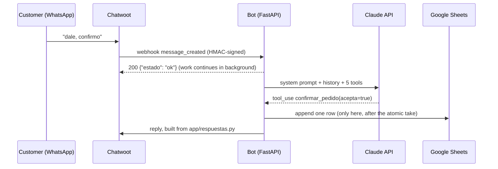
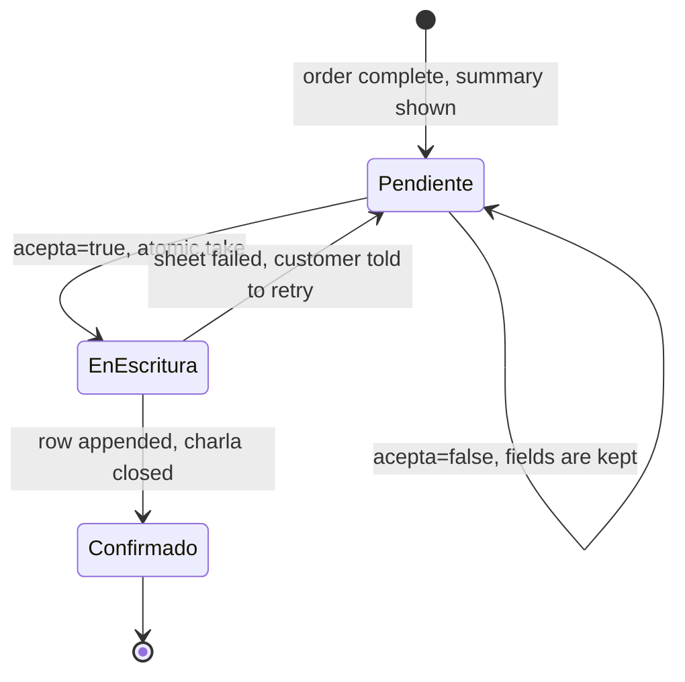

# Architecture

How one WhatsApp message travels through the bot, which module does what, and where state lives. The
short version is in the [README](../README.md); the design decisions have their own records in
[`docs/adr/`](adr/).

Domain names stay in Spanish because they are the names in the code: `pedido` (order), `charla`
(the stored conversation) and `derivar` (hand off to a person). Rules are cited as `R<n>` in code and
tests (for example `R4` in `app/confirmacion.py`).

## One message, end to end

1. `app/main.py` reads the body (1 MB cap), checks the signature (`X-Chatwoot-Signature`, HMAC-SHA256 of
   `<timestamp>.<body>`, 5 minute window), the account id and the inbox id. Only conversations in status
   `pending` belong to the bot; any other status is dropped (`main.py`, `webhook_chatwoot`).
2. The endpoint answers `200` and queues the work. A file attachment opens a window that closes after 8
   seconds of silence, so five photos sent together produce one reply (`ESPERA_LOTE_SEGUNDOS`).
3. `app/turno.py` (`procesar_lote`) takes a per-conversation lock, drops message ids it already processed,
   stores the customer text in SQLite and adds attachments to the pedido before calling the model.
4. `app/agente.py` makes one call to the Claude API and validates the answer into a typed decision.
5. `turno.py` applies the decision. The reply is chosen from `app/respuestas.py`, never from model text.
6. `main.py` sends the reply, the internal note and the status change to Chatwoot, in that order.

## Modules

`app/` is 2,523 lines (`wc -l app/*.py`); the budget is 2,600 and no file passes 300.

| File | Lines | Job |
|---|---|---|
| `main.py` | 246 | Webhook, signature check, file-burst window, `/salud`, one-worker guard |
| `chatwoot.py` | 199 | Payload parsing that never raises; HTTP client for reply, internal note, status |
| `turno.py` | 281 | One batch of messages from dedup to reply; message cap |
| `agente.py` | 234 | Claude call, typed decision, error mapping |
| `prompt.py` | 154 | System prompt: static block (cached) and dynamic block (date, order in progress) |
| `tools.py` | 155 | The five tool schemas and descriptions |
| `respuestas.py` | 285 | Every sentence a customer can read |
| `confirmacion.py` | 142 | Atomic take, sheet write, the "yes" race, handoff |
| `memoria.py` | 297 | SQLite: charla, dedup ids, order generations, confirmations, message counters |
| `pedidos.py` | 144 | `Pedido` model and per-field validation |
| `config.py` | 155 | Business config (Pydantic, `extra="forbid"`), business clock, opening hours, holidays |
| `contactos.py` | 97 | First contact and name, stored as attributes on the Chatwoot contact |
| `sheets.py` | 87 | One `append_row` with `RAW` values and a long timeout |
| `formato.py` | 47 | Log sanitising, Spanish day and month names without `locale` |

## Confirmation

An order is complete when it has seven fields. Completing it does not write anything: it becomes pending in
SQLite and the customer gets a summary.

- The take is one SQLite transaction in `memoria.tomar_para_confirmar`. A second "yes" finds nothing to take
  (`tests/test_confirmacion.py::test_un_segundo_si_despues_de_confirmar_no_contesta`).
- Every take raises a generation number. A message read with an older generation cannot overwrite the order
  (`tests/test_turno.py::test_si_la_generacion_cambio_no_pisa_ni_contesta`).
- For five minutes after the row is written, a message that changes nothing gets no reply and leaves no bot
  turn in the history; a message that changes the order is handed to a person (R6).
- A confirmation held by a process that died is released after five minutes without returning the order to
  pending, because the row may have been written (R25).

## State

| Where | What | Lifetime |
|---|---|---|
| SQLite `charlas` | Customer messages, bot markers, order in progress, contact attributes | 6 hours, 20 messages |
| SQLite `procesados` | Chatwoot message ids already handled | 8 days |
| SQLite `generaciones`, `confirmaciones` | Order generation, confirmation in flight | 30 days, 6 hours |
| SQLite `contadores` | Customer messages per Chatwoot conversation | until a new conversation |
| Chatwoot | The full conversation, contact attributes, status | Chatwoot's own |
| Google Sheet `Pedidos` | One row per confirmed order, 11 columns | permanent |

SQLite opens in WAL mode and re-reads the mode to confirm it, with `secure_delete` on. The server refuses to
start with more than one worker, because two processes would share one file and one in-memory lock per
conversation (`main.py`, `workers_pedidos`).
